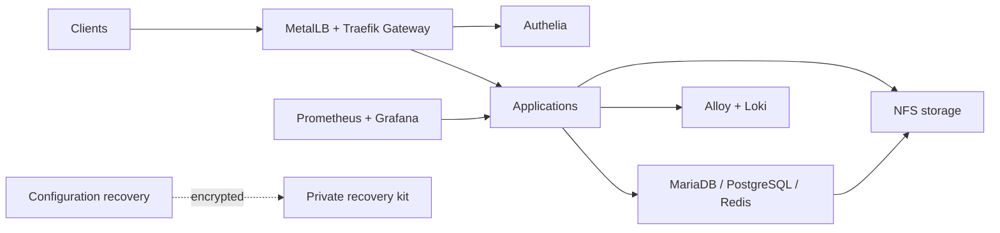

# CHOMS Platforms

A self-hosted platform engineering portfolio: operate real services, encode
intent in Git, and make validation, ownership and recovery reviewable.

**Evidence baseline — 23 October 2026:** three Debian 13 nodes, K3s
`v1.36.2+k3s1`, 18 namespaces, 41 workload controllers, two CronJobs and six
Helm releases. One control-plane; this is not an HA or fully GitOps platform.
These are dated full-platform inventory facts, not a live health claim.
The public checkout is a smaller scope; local private extensions are kept separately.

**Skills demonstrated:** Linux/Kubernetes operations, Gateway API/TLS/identity,
metrics and logs, NFS persistence, reproducible Helm configuration, local CI
validation, staged network isolation and recovery-focused infrastructure code.
Terraform Kubernetes/Helm adoption and an encrypted private recovery kit extend the platform;
Ansible currently covers a node baseline, not complete provisioning.

| Delivery phase | Code/documentation | Operational acceptance |
|---|---|---|
| 1. Shared validation + CI | Implemented | See [validation evidence](docs/operations/LOCAL_VALIDATION.md) |
| 2. NetworkPolicies | Drafted for 13 public namespaces | Not applied; CNI/flows need testing |
| 3. Terraform + recovery kit | Implemented, import-first | Not imported/exported; rebuild drill pending |
| 4. Job retention + cleanup | Implemented/runbook | Not deployed; nothing deleted |
| 5. Documentation + public review | Root notes archived; roadmap reconciled | Owner review pending |

**Start here:** [architecture and inventory](docs/inventory/BASELINE_2026-10-23.md) ·
[network rollout](docs/operations/NETWORK_POLICIES.md) ·
[Terraform adoption](terraform/environments/homelab/IMPORT.md) ·
[recovery kit](docs/operations/RECOVERY_KIT.md) ·
[rebuild procedure](docs/operations/REBUILD_RUNBOOK.md) ·
[cleanup](docs/operations/CLEANUP_RUNBOOK.md) · [public scope](docs/operations/PUBLIC_SCOPE.md) ·
[current roadmap](ROADMAP.md).

Local check: `./scripts/validate.sh`. No cluster or cloud access is needed;
missing tools are reported; security findings remain visible as advisory backlog. Deployment,
imports and recovery drills are separate operator decisions. Author: Oscar Salcedo.
